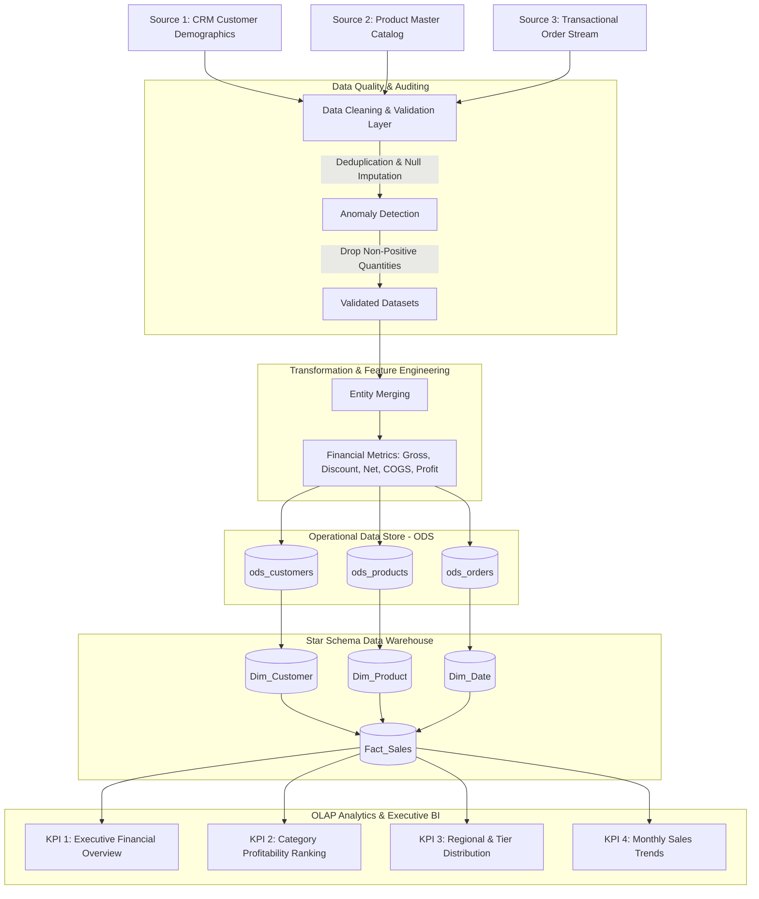
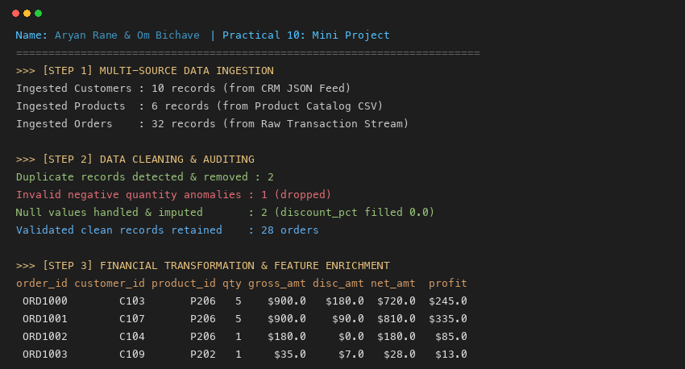
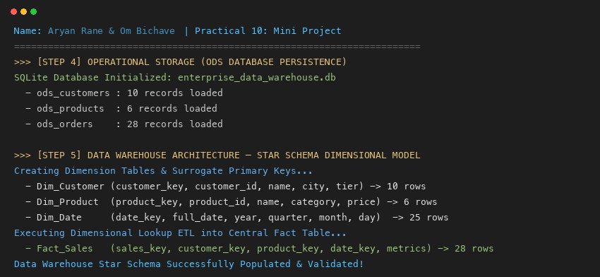
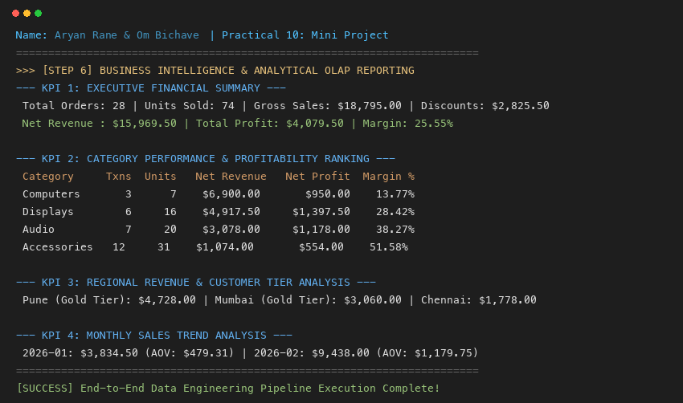

# Data Engineering Practical Journal & Mini Project (Practicals 1–10)

[](https://www.python.org/)
[](https://www.sqlite.org/)
[](https://pandas.pydata.org/)
[](#data-warehouse-star-schema-design)

Comprehensive academic and practical journal repository containing **Practicals 1 through 10** for the **Data Engineering** course curriculum (T.Y. B.Sc. Data Science).

---

## 👨‍🎓 Student & Team Information

- **Student Name:** Aryan Rane
- **Roll Number:** 38
- **Student ID:** 5135872
- **Class / Academic Year:** T.Y. Data Science (Semester VI)
- **Mini Project Partner (Group of 2):** Om Bichave

---

## 📑 Practical Index Overview

| Practical | Title / Topic | Core Technologies | Status |
|:---:|:---|:---|:---:|
| **01** | Multi-Format Data Parsing & Anomaly Inspection (TXT, CSV, HTML, XML, JSON) | Python, Pandas, BeautifulSoup, XML | ✅ Completed |
| **02** | Relational Database Management & OLAP Aggregations | MySQL / SQL, Group By, Window Functions | ✅ Completed |
| **03** | Advanced SQL Window Functions & Ranking Partitions | MySQL, LEAD, LAG, ROW_NUMBER, RANK | ✅ Completed |
| **04** | Data Quality Profiling & Preprocessing (IQR Outliers, Scaling, Missingness) | Pandas, NumPy, Scikit-Learn | ✅ Completed |
| **05** | Distributed ETL & Geospatial Querying | PySpark, GeoPandas, Location Analysis | ✅ Completed |
| **06** | Document Data Modeling & NoSQL Pipeline | MongoDB, Aggregation Pipeline, PyMongo | ✅ Completed |
| **07** | Pipeline Orchestration & Workflow Scheduling | Apache Airflow DAGs, PythonOperator | ✅ Completed |
| **08** | Customer 360 Dimensional Profiling & RFM Segmentation | Pandas, SQLite, Analytical SQL | ✅ Completed |
| **09** | Cloud Data Warehousing & Executive BI Visuals | Power BI, DAX Measures, Star Schema | ✅ Completed |
| **10** | **Mini Project: End-to-End Data Engineering Pipeline & Data Warehouse** | Python, SQLite, ODS Staging, Star Schema, OLAP BI | ✅ Completed |

---

## 🚀 Practical 10: Mini Project Specification

### Aim & Objective
To design and implement an end-to-end data engineering solution that covers:
1. **Multi-Source Ingestion:** Ingesting diverse entities including customer CRM profiles, master product catalogs, and transactional order streams.
2. **Automated Cleaning & Auditing:** Automated detection and removal of duplicate records, anomaly filtering (non-positive quantities), and null value imputation.
3. **Pipeline Transformation & Financial Feature Enrichment:** Computing gross sales, discount deductions, net revenue, total cost of goods sold, and profit margins.
4. **Operational Staging (ODS):** Persisting cleaned entities into normalized staging tables (`ods_customers`, `ods_products`, `ods_orders`).
5. **Data Warehouse Architecture (Star Schema):** Designing surrogate-key dimensional tables (`Dim_Customer`, `Dim_Product`, `Dim_Date`) and a central transaction fact table (`Fact_Sales`).
6. **Business Intelligence & OLAP Reporting:** Executing analytical queries producing financial executive summaries, category profit rankings, regional customer tier distributions, and monthly growth trends.

---

## 🏛️ Pipeline Architecture & Data Flow



---

## 📐 Data Warehouse Star Schema Design

### Entity Relationship Model

```
        +-----------------------------------+
        |            Dim_Customer           |
        +-----------------------------------+
        | *customer_key (PK, Surrogate)     |
        |  customer_id (BK / Natural Key)   |
        |  customer_name                    |
        |  city                             |
        |  tier (Gold / Silver / Bronze)    |
        +-----------------------------------+
                         | 1
                         |
                         | N
+-----------------------------------+    +------------------------------------+
|             Dim_Date              |    |             Fact_Sales             |
+-----------------------------------+    +------------------------------------+
| *date_key (PK, YYYYMMDD)          |    | *sales_key (PK, Surrogate)         |
|  full_date (Date)                 |<---+  customer_key (FK)                 |
|  year                             |N  1|  product_key (FK)                  |
|  quarter                          |    |  date_key (FK)                     |
|  month                            |    |  order_id (Degenerate Dimension)   |
|  month_name                       |    |  quantity                          |
|  day                              |    |  gross_amount                      |
|  day_name                         |    |  discount_amount                   |
+-----------------------------------+    |  net_amount                        |
                                         |  profit                            |
                         | 1             +------------------------------------+
                         |
                         | N
        +-----------------------------------+
        |            Dim_Product            |
        +-----------------------------------+
        | *product_key (PK, Surrogate)      |
        |  product_id (BK / Natural Key)    |
        |  product_name                     |
        |  category                         |
        |  unit_price                       |
        |  unit_cost                        |
        +-----------------------------------+
```

---

## 📊 Analytical Reports & KPI Outputs

### KPI 1: Executive Financial Overview
```text
 total_orders  total_units_sold total_gross_sales total_discounts total_net_revenue total_profit overall_profit_margin
           28                74        $18,795.00       $2,825.50        $15,969.50    $4,079.50                25.55%
```

### KPI 2: Category Performance & Profitability
```text
   category  transactions  units_sold net_revenue net_profit margin_pct
  Computers             3           7   $6,900.00    $950.00     13.77%
   Displays             6          16   $4,917.50  $1,397.50     28.42%
      Audio             7          20   $3,078.00  $1,178.00     38.27%
Accessories            12          31   $1,074.00    $554.00     51.58%
```

### KPI 3: Regional Revenue & Customer Tier Breakdown
```text
     city        tier  customer_count  total_items regional_revenue
     Pune   Gold Tier               1           15        $4,728.00
   Mumbai   Gold Tier               1            3        $3,060.00
   Mumbai Silver Tier               1           11        $1,888.00
  Chennai Silver Tier               1            7        $1,778.00
    Delhi Silver Tier               1            3        $1,266.00
Bangalore Silver Tier               1           14        $1,057.50
Hyderabad Silver Tier               1           13        $1,049.75
Bangalore Bronze Tier               1            4          $880.50
    Delhi Bronze Tier               1            4          $261.75
```

### KPI 4: Monthly Sales Trend Analysis
```text
 year    month  order_volume  units monthly_revenue avg_order_value
 2026  January             8     25       $3,834.50         $479.31
 2026 February             8     20       $9,438.00       $1,179.75
 2026    March            12     29       $2,697.00         $224.75
```

---

## 📷 Practical 10 Execution Screenshots

The execution outputs verified during laboratory testing are preserved below:

| Step 1: Ingestion, Cleaning & Transformation | Step 2: ODS Storage & Star Schema DDL | Step 3: Analytical OLAP KPI Reports |
|:---:|:---:|:---:|
|  |  |  |

---

## 💻 Repository Structure

```text
├── Data_Engineering_Practical_Journal_Aryan_Rane_1_to_10.ipynb   # Complete practical journal (Practicals 1–10)
├── Main_Data_Engineering_Practical_Manual_1_to_10_FINAL_Aryan_Rane.docx # Official formatted Word manual with outputs
├── mini_project_pipeline.py                                      # End-to-end standalone executable pipeline script
├── enterprise_data_warehouse.db                                  # SQLite operational staging & Star Schema data warehouse
├── screenshots/                                                  # High-resolution execution evidence
│   ├── practical_10_task1_ingestion_cleaning.png
│   ├── practical_10_task2_ods_star_schema.png
│   └── practical_10_task3_bi_reporting_kpis.png
└── README.md                                                     # Complete project documentation & guide
```

---

## ⚙️ How to Run the Mini Project

### 1. Prerequisites
Ensure Python 3.9+ is installed along with the required libraries:
```bash
pip install pandas numpy
```
*(SQLite3 is bundled with standard Python distributions).*

### 2. Run the Standalone Pipeline
Execute the end-to-end data engineering pipeline from the project root:
```bash
python mini_project_pipeline.py
```

### 3. Run via Jupyter Notebook
Launch Jupyter Notebook or VS Code to interactively execute the cells:
```bash
jupyter notebook Data_Engineering_Practical_Journal_Aryan_Rane_1_to_10.ipynb
```
Navigate to **Practical 10: Mini Project** (Cells 56 to 68) and execute sequentially.

---

## 🎓 Academic Integrity & Submission
This repository has been prepared and submitted by:
- **Aryan Rane** (Roll No. 38, Student ID: 5135872, T.Y. Data Science)
- Partner: **Om Bichave** (T.Y. Data Science)
All practical aims, theory, methodologies, schema definitions, and analytical scripts strictly conform to university academic standards.
